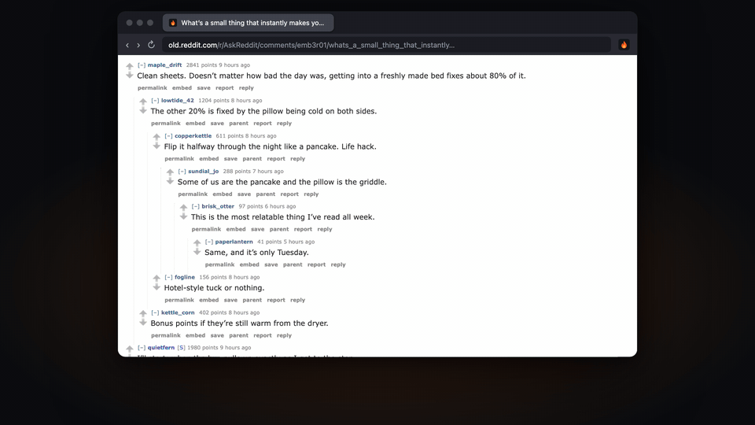
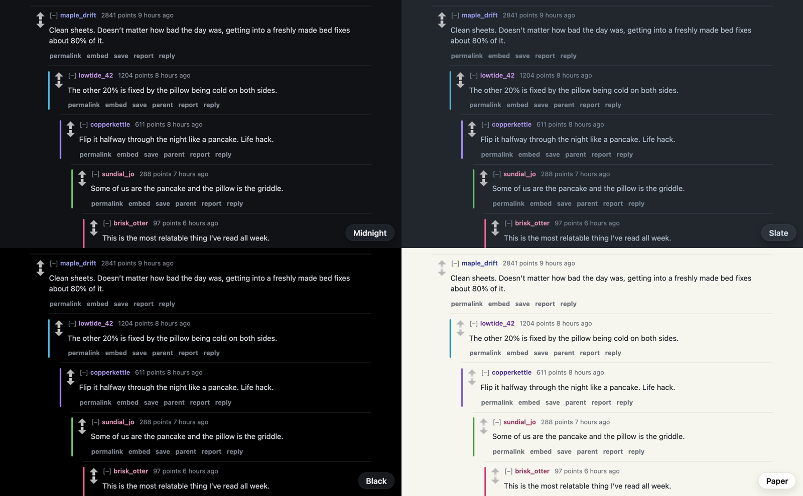
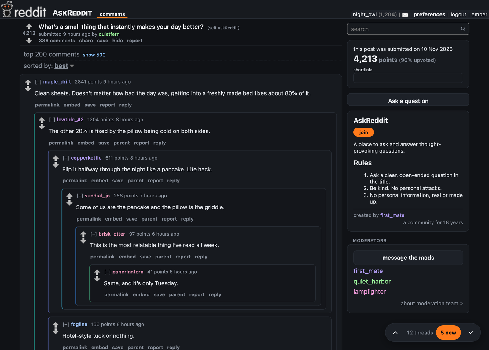
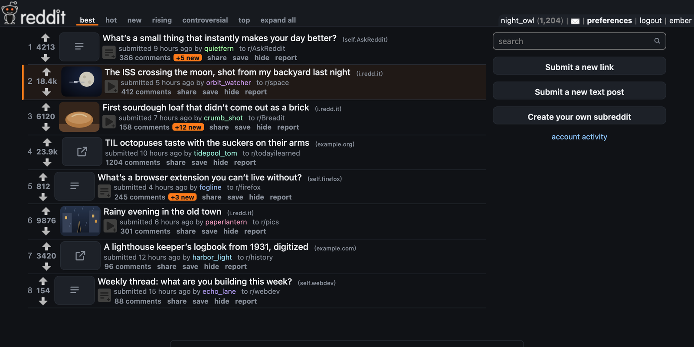
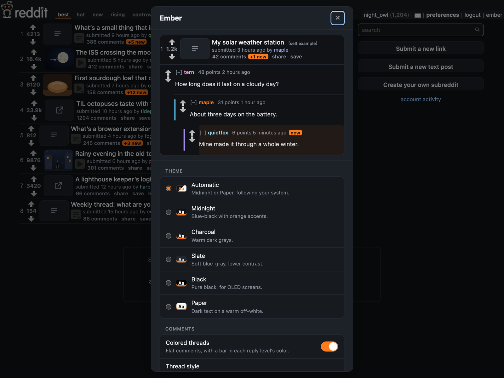

<p align="center"></p>

<h1 align="center">Ember</h1>

<p align="center"><b>A dark skin for old.reddit.com in Firefox, with colored comment threads.</b><br>
Flat comment threads with a colored bar for each level, every author in their own color, jumps between top-level comments, and the comments that are new since your last visit.</p>

<p align="center"><a href="https://github.com/MJuma/ember/releases/latest/download/ember.xpi"><b>Install for Firefox</b></a> · <a href="#using-it">Using it</a> · <a href="#development">Development</a></p>

<p align="center"></p>

Ember restyles Reddit's own pages; it doesn't use Reddit's API. You stay logged in to old.reddit.com as usual, and voting, replying, saving and everything else is Reddit's own.

## Install

1. Download [`ember.xpi`](https://github.com/MJuma/ember/releases/latest/download/ember.xpi) from the [latest release](https://github.com/MJuma/ember/releases/latest). Firefox offers to install it.
2. Open [old.reddit.com](https://old.reddit.com/) and log in. If your account uses the old design on www.reddit.com too (in old reddit's preferences, *Use new Reddit as my default experience* is off), Ember works there as well. The redesign keeps its own look. If you're updating from 0.1, Firefox doesn't grant Ember the new site by itself: allow it once in `about:addons` → Ember → *Permissions* (or, on www.reddit.com, from the extensions button).

Ember updates itself. Each release publishes an `updates.json` that Firefox checks about once a day; to check now, use `about:addons` → ⚙ → *Check for Updates*. Ember is signed by Mozilla as an *unlisted* add-on, so it isn't on addons.mozilla.org.

For an app-like window, pin an old.reddit.com tab (right-click the tab → *Pin Tab*) or keep it in a window of its own. Firefox for Mac can't install a site as an app.

## Using it

- **Themes:** Automatic (Midnight or Paper, following macOS), Midnight, Charcoal, Slate, Black (for OLED screens) and Paper. The theme is applied before the page first paints, so there's no flash of Reddit's white page. Reddit's other pages (search, submitting, the inbox, wikis, profiles) and boxes (archived-thread banners, flairs, formatting help) get the theme too, and dark themes dim pictures a little until you point at them.

  
- **Comments:** each comment sits flat on the page with a thin line above it, and replies get a short bar in their level's color, so you can tell where you are in a deep thread. Click a comment's header (outside its links) to collapse or expand it; selecting text doesn't. A comment's age (*4 hours ago*) links to the comment itself, and hovering it shows the exact time. Set **Thread style** to **Cards** to put each thread in a card, with every reply in a shaded box inside its parent's. **Comment bars** picks the bars' colors: Colorful, Pastel, Ocean, Sunset or Gray. Turn **Colored threads** off for Reddit's nested boxes, and change **Reply indent** to Compact, Normal or Wide.

  
- **Author colors:** each person's name gets a color of its own, the same everywhere, so you can follow who's who in a thread. The post's author (OP) is orange.
- **Jumping around a thread:** the bar in the bottom-right corner shows which top-level comment you're reading (*3 / 137*); ▲ and ▼ jump to the previous and next one, and **N new** jumps to the next new comment. Keys:

  | Key | Does |
  | --- | --- |
  | `n` / `p` | Next / previous top-level comment |
  | `j` / `k` | Next / previous comment |
  | `N` / `P` | Next / previous new comment |
  | `c` | Collapse or expand the comment you're reading |
  | `?` | Ember settings (on any page) |

  Turn off **Thread keys** in settings if you'd rather not use them.

- **New comments:** when you come back to a thread, comments posted since your last visit have an orange tint and a *new* tag. They stay new until they've been on screen for a moment, so refreshing doesn't lose any you hadn't scrolled to. Visits are remembered for 30 days, on this computer only. Only the whole thread counts as a visit; a single comment's permalink page doesn't. In post lists, a thread you've read shows how many comments are new to you since (*41 comments* **+6 new**), counting the ones you didn't reach last time.
- **Post lists:** press `j` / `k` to move between posts (or click one), then act on the selected post with a key. **expand all** in the tabs (or `X`) opens every image, video and gallery in the list in place, and closes them again. The keys click Reddit's own links and buttons, so your Reddit preferences (like opening links in a new tab) still apply.

  | Key | Does |
  | --- | --- |
  | `j` / `k` | Next / previous post |
  | `Enter` | Comments (`⇧Enter` in a new tab) |
  | `o` | Open the link (`⇧O` in a new tab) |
  | `x` / `X` | Expand the post / expand or collapse all images and videos |
  | `a` / `z` | Upvote / downvote |
  | `s` / `h` | Save / hide |

  Turn off **Post list keys** to stop both the keys and the highlight on the post you click.

  

- **Layout:** the page is Wide by default (85% of the window, 92% with the sidebar) and centered; Full and Narrow are in settings. The sidebar sits on the right in the theme's colors: the subreddit's description, the post's details and the moderators are cards, and Reddit's big buttons match the rest of Ember. Turn off **Show sidebar** to hide it. Promoted posts, the multireddit bar down the left of the homepage, and the *Get new Reddit* button are hidden. Placeholder thumbnails (text posts, links, NSFW, spoilers) are drawn in the theme's colors instead of Reddit's light gray boxes.
- **Subreddit styles:** subreddits' own stylesheets are off, since they'd fight the theme. Turn on **Subreddit styles** to see each subreddit's own look instead of Ember's theme; the comment layout, colors and navigation keep working.
- **Settings:** click **ember** next to your username at the top right, or press `?`. A sample post and replies at the top show your changes as you make them, even on a post list. Settings sync between computers with Firefox Sync when *Add-ons* is ticked in Settings → Sync. Under **Data** you can reset your settings or clear your reading history.

  

Ember makes no network requests and collects nothing. It needs only the `storage` permission and access to old.reddit.com and www.reddit.com.

## Development

### Setup

The same on macOS and Linux. You need Firefox, [Node.js](https://nodejs.org/) 22 or newer, and [pnpm](https://pnpm.io/installation).

1. Install pnpm, if you don't have it. Any recent version works: in this repo it switches itself to the version `package.json` pins.

   ```bash
   npm install -g pnpm --allow-scripts=pnpm
   ```

   If npm's global folder needs `sudo` (Node from a Linux package manager), add `--prefix ~/.local` and make sure `~/.local/bin` is on your `PATH`. Without `--allow-scripts`, newer npm skips pnpm's install script and leaves a slower `pnpm` that other programs can't start. Homebrew (`brew install pnpm`) or `corepack enable` (Node 22 and 24) work too.

2. Install the dev tools:

   ```bash
   pnpm install
   ```

3. Run Ember from this checkout:

   ```bash
   pnpm dev
   ```

   This builds Ember into `dist/` and opens old.reddit.com in a separate Firefox window with Ember loaded. It uses its own profile in `.dev-profile/` (git-ignored), so your everyday Firefox and its copy of Ember aren't touched. Log in to Reddit in that window the first time and you stay logged in.

   Leave it running while you work. Saving a file under `src/content/` or `src/lib/` rebuilds Ember and reloads the add-on (or press `R` in the terminal); reload the tab to see the change. Changes to `src/manifest.json` or the icons need a restart. Stop with Ctrl+C or by quitting that Firefox.

- Delete `.dev-profile/` to start over, logged out and with default settings.
- `web-ext` finds Firefox in its usual place: `/Applications` on macOS, `firefox` on your `PATH` on Linux. To use another build, pass it through: `pnpm dev --firefox=nightly` (or `deved`, `flatpak:org.mozilla.firefox`, or a path). Other `web-ext run` options work the same way.
- Ember's errors show in the tab's web console (F12).

### Commands

```bash
pnpm dev                  # Ember in a separate Firefox (profile kept in .dev-profile/), rebuilding and reloading on save
pnpm test                 # vitest unit tests for the pure modules in src/lib
pnpm lint                 # oxlint (type-aware) + web-ext lint
pnpm build                # type-check, then bundle into dist/
pnpm fixtures [pages]     # scrub saved old.reddit pages into test/fixtures (see Fixtures)
pnpm check [part]         # load Ember into the fixtures in Chromium: behavior checks + screenshots
pnpm sign                 # signed .xpi, with AMO keys from the Keychain (see Releasing)
```

`pnpm lint` reports warnings about `innerHTML`. They're expected: the settings panel escapes everything it renders (`escape` in `src/content/panel.ts`), and the nav bar's markup is static.

### Fixtures

Reddit sends logged-out visitors from old.reddit.com to a login page and blocks automated logins, so the checks use pages you save yourself. In Firefox, save some old.reddit pages with *File → Save Page As… → Web Page, complete* (a long thread named `deep-thread-post.html` and a subreddit named `subreddit-page.html` are the ones `pnpm check` needs), then run `pnpm fixtures ~/Downloads/*.html`. The script removes scripts (where the session token lives), your account links and subscriptions, and form values, replaces your username with `ember_user`, and copies only stylesheets and images. Fixtures stay out of git: they're other people's posts.

`pnpm check` serves the fixtures at their real paths, stubs `browser.storage`, and injects Ember first in `<head>` (like `document_start`, with its stylesheet before Reddit's). It checks the theme, collapsing, keys, the nav bar, settings (the sample, Cards, comment bars and Data), new comments, post lists (keys, *+N new*, expand all, and that with the sidebar hidden they're as dense as Reddit's), the sidebar (themed, and nothing in the page under it) and subreddit styles, scans every saved page in Midnight and Paper for anything still light, hard to read or drawn with Reddit's sprites, and saves screenshots of every theme to `.measure/shots/`. It needs Playwright's Chromium (`pnpm exec playwright-core install chromium`); Playwright's Firefox doesn't start on macOS here, so check in real Firefox with `pnpm dev` too.

### Releasing

Bump `version` in both `src/manifest.json` and `package.json` (CI checks they match) and push to `master`. [`release.yml`](.github/workflows/release.yml) builds, runs the tests and lint, has Mozilla sign the add-on (unlisted), and publishes a GitHub Release `v<version>` with `ember.xpi` and `updates.json`. Pushes that don't change the version don't release. Installed copies pick up the new version through `update_url` in the manifest, which points at the latest release's `updates.json`.

Signing needs two repository secrets, `AMO_JWT_ISSUER` (like `user:12345:67`) and `AMO_JWT_SECRET` (64 hex characters), from <https://addons.mozilla.org/developers/addon/api/key/>. The same keys as any other add-on of yours work.

Mozilla signs each version number once, so leave signing to CI. `pnpm sign` is for a one-off local build of a version you won't release; it reads the same keys from the macOS Keychain (or `WEB_EXT_API_KEY` / `WEB_EXT_API_SECRET`):

```bash
security add-generic-password -U -s amo-jwt-issuer -a "$USER" -w   # JWT issuer
security add-generic-password -U -s amo-jwt-secret -a "$USER" -w   # JWT secret
```

### How it's put together

Ember is one content script and one stylesheet, injected into old.reddit.com at `document_start`. The stylesheet does almost everything: it keys off attributes the script sets on `<html>` (`data-ember-theme`, `data-ember-threads` and so on), so a setting changes the page without re-rendering anything. Ember's own controls are plain elements in the page.

| File | Role |
| --- | --- |
| `src/manifest.json` | Content script for `https://old.reddit.com/*` and `https://www.reddit.com/*`, `storage` permission. |
| `src/content/ember.css` | Themes, layout, colored threads (Flat or Cards, and the bar palettes), author colors, new comments, and Ember's nav bar and settings panel. |
| `src/content/main.ts` | Entry point. On old reddit's pages only (not the redesign, which www.reddit.com also serves), applies settings and turns off subreddit styles at `document_start`, then enhances the page once it's parsed. |
| `src/content/store.ts` | Settings in `storage.sync`, mirrored to the page's `localStorage` so the theme is applied synchronously before first paint. Sets the `<html>` attributes. |
| `src/content/subreddit.ts` | Switches subreddit stylesheets off (`media="not all"`) as they appear, unless Subreddit styles is on; sets `data-ember` when Ember's theme applies. |
| `src/content/page.ts` | Author colors, the settings link, keys, and the thread or post-list features, including comments added later by *load more comments*. |
| `src/content/listing.ts` | Post lists: the selected post, its keys, and expand all. |
| `src/content/comments.ts` | Collapsing from the header, the age permalink, author hues. |
| `src/content/navbar.ts` | The jump commands and the floating nav bar. |
| `src/content/newComments.ts` | Which comments are new, marking them seen as they're read, and saving the visit (with the thread's comment count) in `storage.local`; the *+N new* counts on post lists. |
| `src/content/panel.ts` | The settings dialog, with its live sample and Data (reset settings, clear reading history). |
| `src/lib/` | Pure, tested logic: the settings schema and decoding, visits, jump targets, name hues. |
| `scripts/build.mjs` | esbuild bundle of the content script into `dist/`, plus the stylesheet, manifest and icons. `--watch` for `pnpm dev`. |
| `scripts/dev.mjs`, `scripts/fixtures.mjs`, `scripts/check.mjs` | `pnpm dev`, `pnpm fixtures`, `pnpm check`. |
| `.github/workflows/` | `ci.yml` builds, tests and lints pull requests; `release.yml` signs and releases version bumps. |
| `docs/` | README media: the demo GIF, stills and the social preview. They show Ember's real script and stylesheet on made-up old.reddit pages (no real users or posts), rendered with the `/brag-slim` skill; its work files stay in the git-ignored `brag-output/`. |
